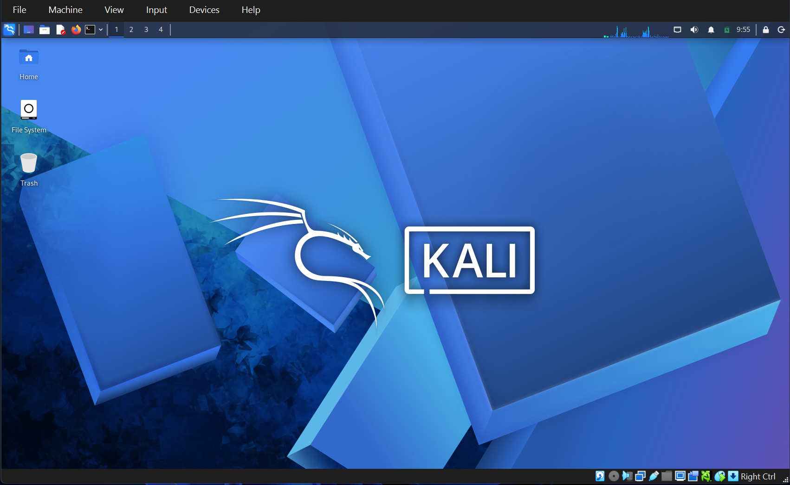
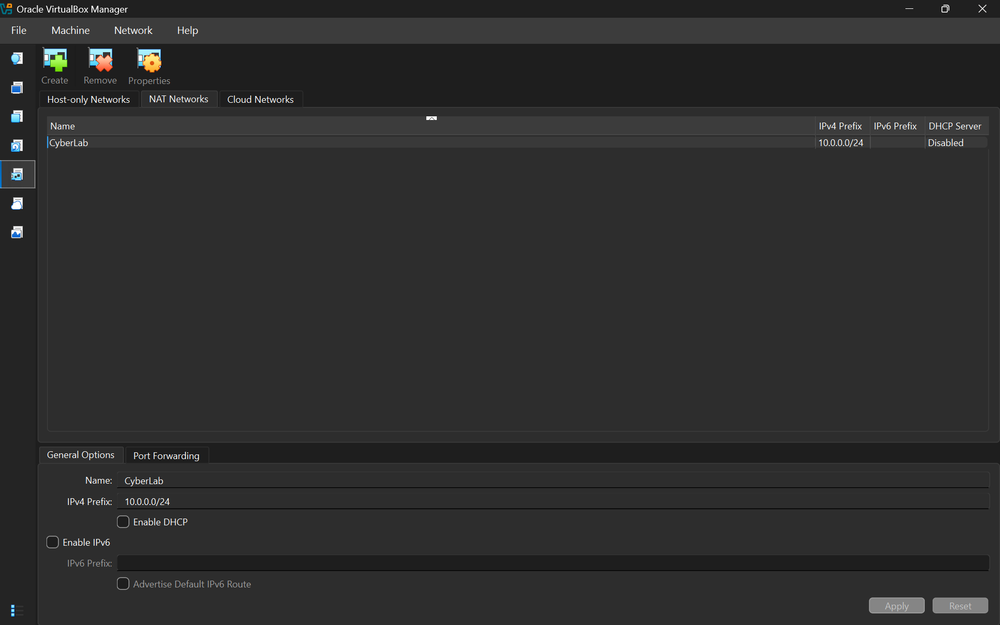
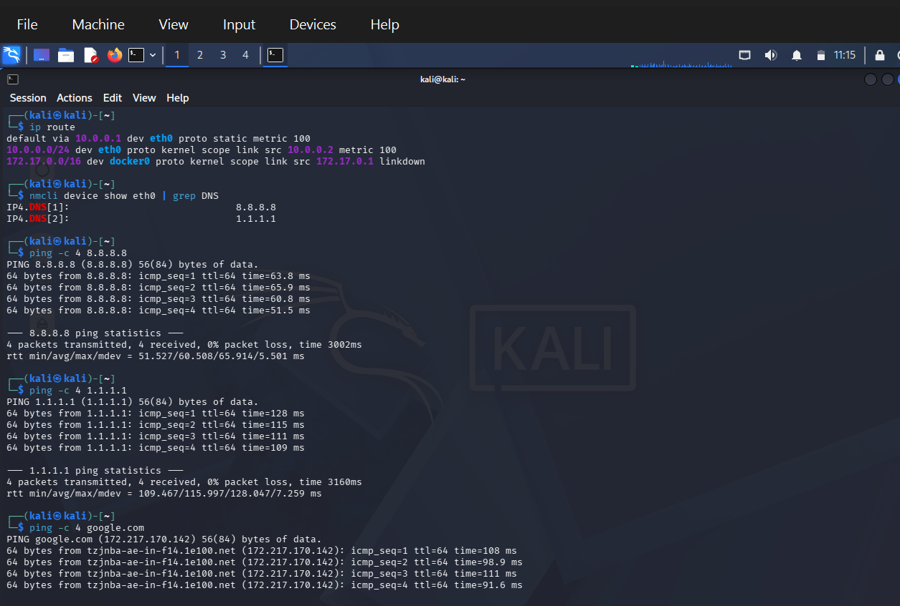
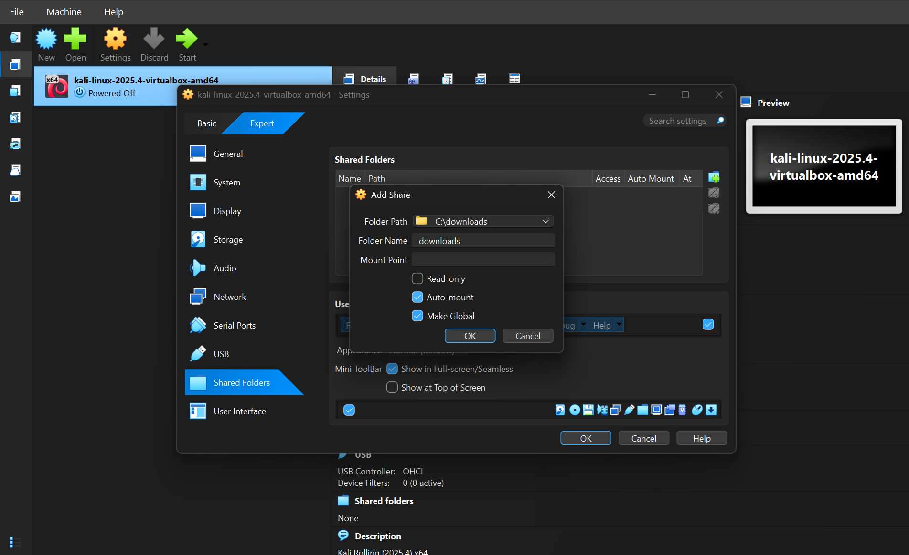
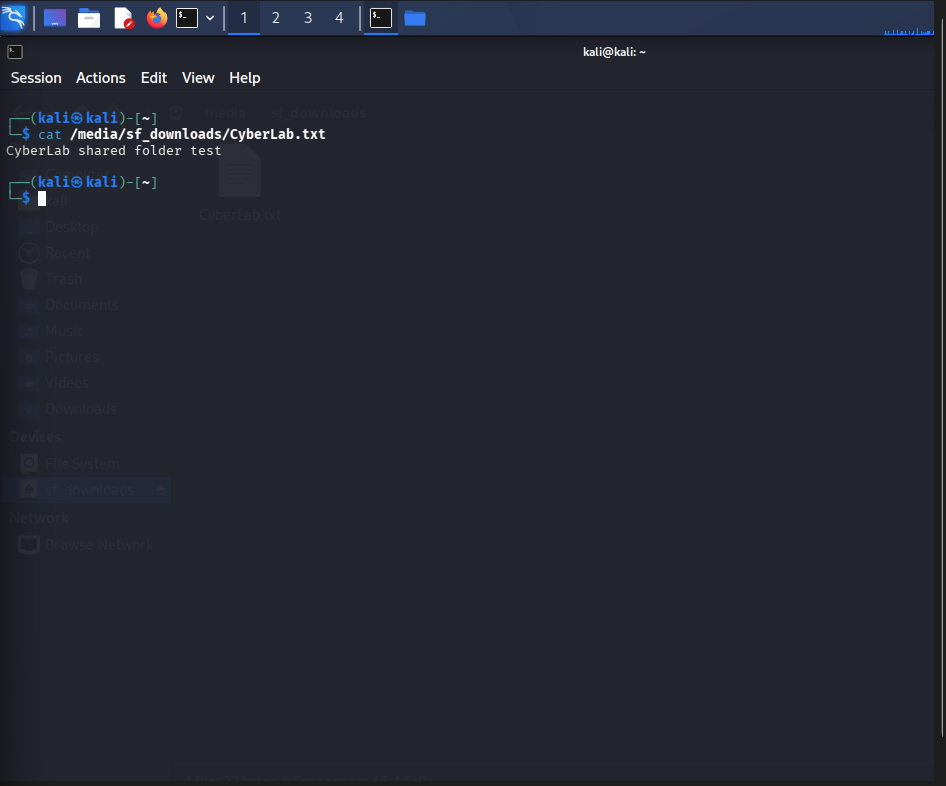
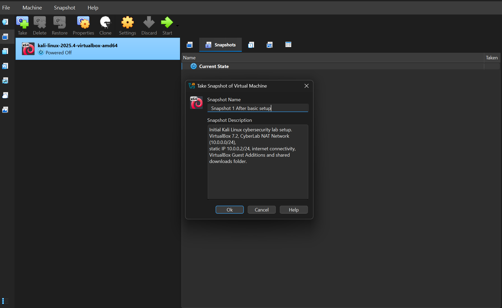

# NETWORKWALKS-B084-WK1-P1-CYBERSECURITY-LAB-SETUP
Documentation of my cybersecurity lab setup using VirtualBox 7.2, Kali Linux, NAT Network, static IP configuration, shared folders, and VM snapshots.

# Kali Linux Cybersecurity Lab Setup

## Project Overview

This project documents the setup and configuration of a virtual cybersecurity laboratory using Oracle VirtualBox and Kali Linux.

The lab provides a controlled environment for learning network security, ethical hacking, penetration testing, and security assessment techniques.

The environment uses a VirtualBox NAT Network to provide internet connectivity and allow additional virtual machines to be connected for future security testing exercises.

## Project Objectives

- Install and configure Kali Linux in VirtualBox.
- Create a dedicated NAT Network for the cybersecurity lab.
- Configure a static IPv4 address for Kali Linux.
- Establish internet connectivity through the virtual network.
- Enable clipboard sharing and drag-and-drop functionality.
- Configure a shared folder between Windows and Kali Linux.
- Create a VM snapshot as a recovery point.
- Document the configuration and verification process.

## Lab Environment

| Component | Configuration |
|---|---|
| Host Operating System | Windows 11 |
| Virtualization Platform | Oracle VirtualBox 7.2 |
| Virtual Machine | Kali Linux |
| Network Type | NAT Network |
| Network Name | CyberLab |
| Network CIDR | 10.0.0.0/24 |
| Kali IP Address | 10.0.0.2/24 |
| Default Gateway | 10.0.0.1 |
| Primary DNS | 8.8.8.8 |
| Secondary DNS | 1.1.1.1 |
| Network Interface | eth0 |
| Shared Folder | C:\downloads |
| Guest Additions | Installed |

## Lab Configuration

### 1. Kali Linux Installation

Kali Linux was installed as a virtual machine using Oracle VirtualBox. The installation provides the operating system and security tools required for the cybersecurity laboratory.



### 2. NAT Network Configuration

A dedicated NAT Network named `CyberLab` was created in VirtualBox.

Network configuration:

- Network Name: CyberLab
- IPv4 Prefix: 10.0.0.0/24
- DHCP: Disabled
- IPv6: Disabled

The NAT Network provides a private virtual network for the laboratory and allows connected virtual machines to communicate with one another.



### 3. Static IP Configuration

Kali Linux was configured with a static IPv4 address using NetworkManager.

The following configuration was applied:

| Parameter | Value |
|---|---|
| Interface | eth0 |
| IP Address | 10.0.0.2 |
| Subnet Mask | 255.255.255.0 |
| Gateway | 10.0.0.1 |
| DNS | 8.8.8.8, 1.1.1.1 |

The static IP address provides a consistent network identity for the Kali virtual machine.

### 4. Network Verification

The network configuration was verified using Linux networking utilities.

Commands used:

```bash
ip addr show eth0
ip route
nmcli device show eth0
```

Connectivity tests:

```bash
ping -c 4 10.0.0.1
ping -c 4 1.1.1.1
ping -c 4 8.8.8.8
ping -c 4 google.com
```

The external IP connectivity tests to 1.1.1.1 and 8.8.8.8 returned successful replies with no packet loss.

The DNS configuration was set to 8.8.8.8 and 1.1.1.1. Domain resolution is to be verified separately.



### 5. Shared Folder Configuration

A shared folder was configured to enable file exchange between the Windows host and Kali Linux.

Configuration:

- Host folder: C:\downloads
- Shared folder name: downloads
- Auto-mount: Enabled
- Access: Read and Write

VirtualBox Guest Additions were installed to support shared-folder functionality.

The shared folder was tested successfully by creating a test file on Windows and accessing it from Kali Linux.



### 6. Virtual Machine Snapshot

A snapshot was created to preserve the configured Kali Linux environment.

Snapshot name:

`Kali-Lab-Initial-Setup`

The snapshot provides a recovery point that can be used to restore the virtual machine to its initial laboratory configuration before conducting further experiments.



## Troubleshooting

### Network Activation Failure

During static IP configuration, NetworkManager initially failed to activate the connection.

The problem was traced to a mismatch between the VirtualBox NAT Network subnet and the configured Kali IP address.

The NAT Network was corrected from:

`10.0.2.0/24`

to:

`10.0.0.0/24`

The connection was subsequently activated successfully.

### VirtualBox Network Compatibility

The following command was also applied as a workaround for the network activation issue:

```bash
sudo nmcli connection modify "Wired connection 1" ipv4.dad-timeout 0
```

## Lessons Learned

Through this project, I gained practical experience in:

- Virtual machine installation and configuration.
- VirtualBox NAT Network management.
- IPv4 addressing and subnet configuration.
- Static IP configuration using NetworkManager.
- Default gateway and DNS configuration.
- Network connectivity troubleshooting.
- VirtualBox Guest Additions and shared folders.
- Virtual machine snapshots and recovery.

## Future Improvements

The laboratory can be extended by adding:

- A Windows target virtual machine.
- Additional Linux virtual machines.
- Network scanning and reconnaissance exercises.
- Wireshark packet analysis.
- Vulnerability assessment exercises.
- Controlled penetration-testing scenarios.

## Security and Ethical Use

This laboratory is intended for educational purposes and authorized security testing only.

All security assessments should be conducted against systems owned by the user or systems for which explicit testing permission has been granted.

## Tools and Technologies

- Oracle VirtualBox
- Kali Linux
- Windows 11
- NetworkManager
- Linux networking utilities
- VirtualBox Guest Additions

---

---

---

## 👤 Author

**Idra Shabani Mkumbanya**  
Cybersecurity Intern, Batch B084

**LinkedIn:** [Idra Mkumbanya](https://www.linkedin.com/in/idra-mkumbanya-469702207)

---

## 📌 Project Information

**Program Name:** Cybersecurity at Networkwalks  
**Week:** 01  
**Program** Cybersecurity Internship at Networkwalks | Week 01 | Project: Cybersecurity & Pentesting Lab Setup  
**Repository:** NETWORKWALKS-B084-WK1-P1-CYBERSECURITY-LAB-SETUP
